# Chef referral flow

This is the proposed end-to-end flow for chef referrals on Saveful Hero and
Legend mobile subscriptions. Hero and Legend are purchased through RevenueCat
and the App Store or Google Play; Stripe is not part of this flow.

## End-to-end flow

```mermaid
flowchart TD
  subgraph chefLane [Chef]
    chefProfile["EXISTING: Approved ChefProfile with a unique slug"]
    referralIdentity["NEW: One enabled referral token mapped to the chef"]
    shareAssets["NEW: Referral link, QR for the same link, and manual code"]
    chefProfile --> referralIdentity --> shareAssets
  end

  subgraph acquisitionLane [Referral acquisition]
    openReferral["Subscriber opens the link or scans the QR"]
    installed{"Saveful already installed?"}
    directOpen["Universal link opens Saveful with the referral token"]
    rememberToken["NEW: Deferred-link provider preserves the token"]
    installApp["Subscriber installs Saveful from the app store"]
    restoreToken["NEW: First app open restores the token"]
    manualCode["Subscriber enters the same token manually"]

    openReferral --> installed
    installed -->|"Yes"| directOpen
    installed -->|"No"| rememberToken --> installApp --> restoreToken
  end

  subgraph subscriberLane [Subscriber app and account]
    captureToken["Capture the referral token"]
    signedIn{"Subscriber signed in?"}
    otpSignup["EXISTING: OTP signup or login; NEW: keep token through auth"]
    referralReady["Referral is ready to bind to this account"]
    referralPaywall["NEW: Show Hero or Legend referral package with 5% off the first paid period"]
    mobilePurchase["EXISTING: Purchase through RevenueCat and the mobile store"]
    recurringPrice["Store charges the referral price once; later renewals use the standard price"]

    captureToken --> signedIn
    signedIn -->|"No"| otpSignup --> referralReady
    signedIn -->|"Yes"| referralReady
    referralPaywall --> mobilePurchase --> recurringPrice
  end

  subgraph backendLane [Saveful backend]
    validateToken["NEW: Resolve token and validate chef, status, self-referral, and subscriber eligibility"]
    validReferral{"Referral valid and eligible?"}
    normalFlow["Continue with the normal paywall; no referral discount or chef credit"]
    bindReferral["NEW: Bind and lock subscriber to chef before purchase"]
    revenueCatWebhook["EXISTING: POST /api/webhook/revenuecat updates subscription access"]
    claimTransaction["NEW: Claim event and store transaction idempotently"]
    duplicateEvent{"Transaction already processed?"}
    eventOutcome{"RevenueCat event outcome"}
    paidCheck{"Initial purchase or renewal with positive revenue and a bound referral?"}
    noCommission["Do not create commission; wait for a later eligible paid event"]
    financeFields{"Price, tax, and store commission fields available?"}
    reconciliationHold["Hold for finance reconciliation; do not estimate missing values"]
    calculateCommission["NEW: Net proceeds = price in purchase currency × 1 minus tax percentage minus store commission percentage; chef commission = 10% of net"]
    commissionLedger["NEW: Create a pending commission ledger row in minor units and transaction currency"]
    refundLookup["NEW: Find commission by original store transaction"]
    reverseCommission["NEW: Reverse pending earnings or create a negative balance adjustment if already paid"]
    stopFutureEarnings["Update subscription state; create no commission without another successful payment"]

    validateToken --> validReferral
    validReferral -->|"No"| normalFlow
    validReferral -->|"Yes"| bindReferral
    revenueCatWebhook --> claimTransaction --> duplicateEvent
    duplicateEvent -->|"Yes"| ignoredEvent["Ignore duplicate safely"]
    duplicateEvent -->|"No"| eventOutcome
    eventOutcome -->|"Initial purchase or renewal"| paidCheck
    paidCheck -->|"No, including a free trial"| noCommission
    paidCheck -->|"Yes"| financeFields
    financeFields -->|"No"| reconciliationHold
    financeFields -->|"Yes"| calculateCommission --> commissionLedger
    eventOutcome -->|"Refund or chargeback"| refundLookup --> reverseCommission
    eventOutcome -->|"Cancellation, expiry, or billing issue"| stopFutureEarnings
  end

  subgraph payoutLane [Admin, finance, and chef]
    payoutReview["NEW: Admin reviews payable chef balances"]
    payoutReady{"Payment details verified and payout approved?"}
    payoutHold["Hold balance and request or verify payment details"]
    sendPayout["NEW: Send payout and record provider reference"]
    paidLedger["NEW: Mark included ledger rows paid"]
    chefStatement["NEW: Chef sees aggregate referrals, earnings, reversals, and payout status"]

    payoutReview --> payoutReady
    payoutReady -->|"No"| payoutHold --> payoutReview
    payoutReady -->|"Yes"| sendPayout --> paidLedger --> chefStatement
  end

  shareAssets --> openReferral
  shareAssets --> manualCode --> captureToken
  directOpen --> captureToken
  restoreToken --> captureToken
  referralReady --> validateToken
  bindReferral --> referralPaywall
  recurringPrice --> revenueCatWebhook
  commissionLedger --> payoutReview
  reconciliationHold --> payoutReview
  reverseCommission --> payoutReview
```

## Confirmed commercial rules

- The subscriber receives **5% off the first paid billing period only**.
  Renewals are charged at the normal store price.
- The chef earns **10% of net proceeds** on the first positive paid
  transaction and every successful renewal attributed to that chef.
- Net proceeds are calculated per transaction and currency:
  `price_in_purchased_currency × (1 - tax_percentage - commission_percentage)`.
- Trials and other zero-price transactions create no commission. The first
  later transaction with positive revenue can create it.
- A refund or chargeback reverses the related commission. If that commission
  has already been paid, the reversal becomes a negative balance adjustment
  against a later payout.
- Cancellation, expiry, or a billing issue does not itself reverse valid
  earnings. It only stops new earnings until another successful payment occurs.
- Referral attribution is locked to the subscriber before purchase so changing
  links later cannot redirect historical or future renewal credit.

## Operational safeguards

- The QR contains the same universal referral URL that the chef can share; the
  visible code is a fallback for subscribers who cannot open the link.
- The subscriber must see the actual store-confirmed referral price before
  approving payment. The App Store or Google Play applies the discount, not the
  Saveful backend.
- Commission amounts are rounded and stored in integer minor units. Different
  currencies remain separate until finance defines a payout conversion policy.
- RevenueCat event IDs and store transaction IDs must be unique in the ledger.
  Retried or out-of-order webhooks must not create duplicate earnings.
- RevenueCat financial fields are estimates. Missing fields place an earning on
  hold, and payable balances should be reconciled against RevenueCat exports or
  store settlement reports before payment.
- Chef statements should be aggregate and must not expose subscriber personal
  information.

## Implementation

### Backend (`src/modules/referral/`)

| Piece | Where |
|---|---|
| Codes, links, public lookup | `referral-code.service.ts`, schema `referral-code.schema.ts` |
| Subscriber binding and discount eligibility | `referral-attribution.service.ts`, schema `referral-attribution.schema.ts` |
| RevenueCat event log and commission ledger | `referral-ledger.service.ts`, schemas `revenuecat-event.schema.ts`, `referral-ledger-entry.schema.ts` |
| Quarterly payouts and statement email | `referral-payout.service.ts`, schema `referral-payout.schema.ts` |
| Chef portal summary | `referral-chef.service.ts` |
| Admin overview and payout details | `referral-admin.service.ts` |
| Retry of failed ledger steps (every 10 min) | `referral.cron.ts` |
| Money and event rules (pure, unit tested) | `referral-math.ts` |

The RevenueCat webhook logs every event to `RevenueCatEvent` before syncing
subscription access, then applies it to the ledger. The ledger does not use
the subscription document's ordering filter, so late renewals still earn.
Signup binds a code sent with `POST /api/auth/request-otp` (`referralCode`,
`referralSource`) when the account is created in `verify-otp`.

### Endpoints

- `GET /api/referrals/codes/:code`: public, rate-limited lookup.
- `POST /api/referrals/bind`, `GET /api/referrals/me`: signed-in customer.
- `GET /api/chef/referrals/summary`, `GET /api/chef/referrals/statements`: role CHEF.
- `/api/admin/referrals/*`: role ADMIN. Covers chefs overview, payment
  details, codes, attributions (void and reassign before the first payment),
  ledger (resolve or void held entries, adjustments) and payouts (generate,
  approve, mark paid, void, export).

### Configuration

| Variable | Service | Purpose |
|---|---|---|
| `REFERRAL_IOS_OFFER_CODES` | sv1 | JSON map of App Store product id to custom offer code, e.g. `{"saveful.hero.monthly":"CHEFHEROM"}` |
| `REFERRAL_APPLE_APP_ID` | sv1 | Numeric App Store id, used for the offer-code redemption URL |
| `REFERRAL_LINK_BASE_URL` | sv1 | Optional; defaults to `https://admin.saveful.app/r` |
| `CHEF_PORTAL_URL` | sv1 | Optional; link in the statement email |
| `NEXT_PUBLIC_IOS_APP_STORE_ID` | web | App Store listing for the landing page |
| `REFERRAL_APP_LINKS_ENABLED` | web | `true` adds `/r/*` to the iOS universal links |

### Store setup

- **App Store Connect**, for each of `saveful.hero.monthly`,
  `saveful.hero.yearly`, `saveful.legend.monthly`, `saveful.legend.yearly`:
  an offer code for new subscribers, with "redeem introductory offer first"
  set to Yes. Pricing is pay as you go for 1 period at the nearest price point
  at or below 95%. Add one custom code (no end date) and list it in
  `REFERRAL_IOS_OFFER_CODES`.
- **Play Console**, on each base plan: offer `chef-referral-5`. Eligibility
  is new customer acquisition, with phases of a 7-day free trial then 1
  period at 5% off. Tags are `chef-referral` and `rc-ignore-offer`.

### Rollout

1. Deploy sv1. Events are logged from day one, before any codes are shared.
2. Configure the store offers and test them in sandbox.
3. Deploy web with `REFERRAL_APP_LINKS_ENABLED` unset.
4. Ship the app release that handles `/r/<code>`, then set
   `REFERRAL_APP_LINKS_ENABLED=true`. Older iOS builds would open the link
   and drop the code.
5. Pilot with a few chefs, then open referrals to all approved chefs.
